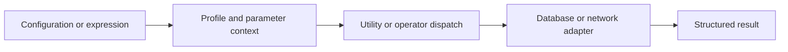
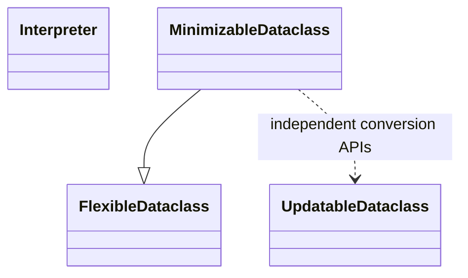
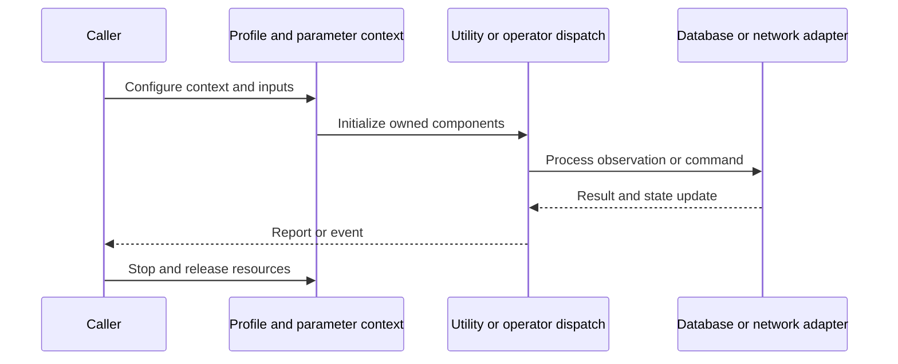
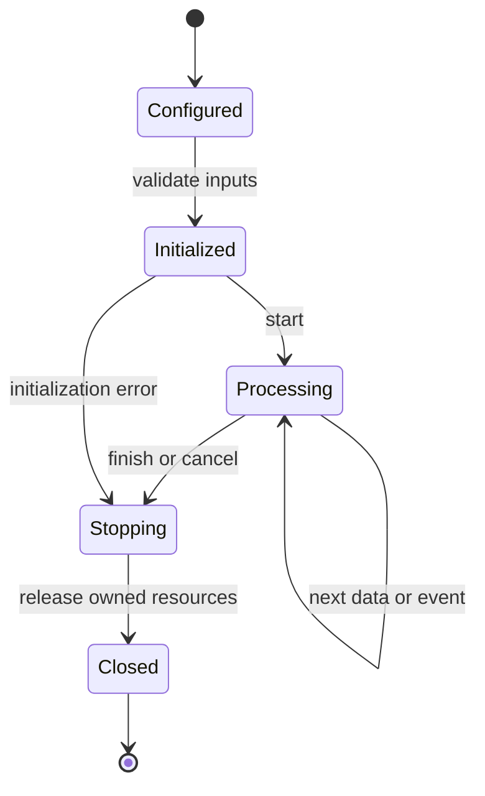
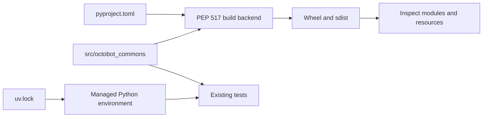
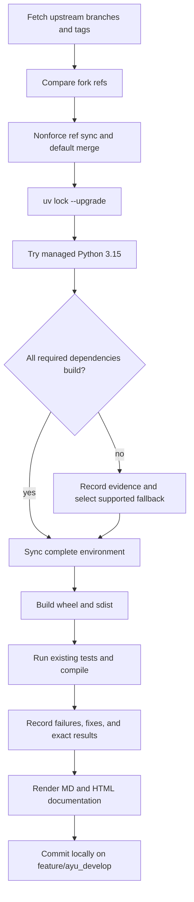

# OctoBot-Commons: architecture and development

Commons provides shared configuration, profiles, databases, cryptography, DSL evaluation, and asynchronous utilities for the standalone OctoBot ecosystem. It has no exchange execution loop of its own.

## Components and boundaries

Small modules own focused utilities, while profile and database objects define the persistent boundaries. The DSL Interpreter dispatches expression nodes through operator implementations and explicit parameters/dependencies. FlexibleDataclass supports structured conversion; MinimizableDataclass inherits that behavior to omit default fields. HTTP counting is implemented with aiohttp tracing on a standard ClientSession, preserving client behavior without subclassing an unsupported library class.

The following class view names implementation classes. Cross-package types are supplied by the host ecosystem; arrows describe inheritance or usage, not copied ownership.

## Runtime workflow

A caller loads configuration and profile data, resolves runtime identifiers, opens the required database or network resource, and consumes structured results. DSL evaluation receives an expression and parameter context, recursively evaluates supported operators, and returns a value. Database adapters and resource owners are closed by their callers.

This sequence is an architectural view of responsibility and resource ownership. Individual plugin, connector, and strategy implementations can add asynchronous events and error branches. The lifecycle below is a conceptual operating workflow, rather than a claim that every component has one shared state enum.

## Features and extension points

Profile import/export; authenticated AES-GCM encryption; SQLite-backed run data; DSL custom operators; configuration schemas; request rate counters; time-frame conversion and logging helpers.

Extend the owning component behind its existing public interface. Keep metadata and configuration alongside plugin/strategy resources. Exchange-specific behavior belongs in an adapter; strategy decisions belong in the strategy/evaluator layer; persistence schema and migrations belong with the storage implementation. Review the source map below before changing a boundary, and exercise the existing tests associated with that boundary.

## Packaging and dependency design

The standalone library is distinct from the newer Commons copy in the OctoBot monorepo. Its uv sources are consumed by Backtesting, Evaluators, and Trading. Python 3.15 works with the upgraded direct dependencies. Existing crypto corruption fixtures now flip a bit so randomized ciphertext cannot accidentally remain unchanged; assertions and test count are preserved.

The lock records exact package versions, hashes, platform markers, and local source mappings. Path sources deliberately bind related repositories in this workspace; clone sibling repositories at the documented names before synchronization. Published packaging metadata describes public dependencies, while uv source settings select this development workspace. Resolve dependency changes with uv lock --upgrade and retain the generated lock, then verify the same locked environment.

## Maintenance workflow

All upstream branches and tags are fetched. Fork updates use nonforce pushes; a divergent branch is merged without erasing fork history. The default branch is merged into feature/ayu_develop with package/resource conflicts reconciled in their installed locations. Build and test evidence is recorded before a local maintenance commit. Feature branch publication is a separate root-level action.

No existing test assertions are removed and no new test cases are introduced in this maintenance pass. Corrected fixtures preserve coverage while making paths, corruption inputs, and resource cleanup compatible with the selected interpreter. A failed test or unsupported dependency is reported explicitly in [validation](validation.md); package build success does not imply strategy correctness, profitability, or successful live connectivity.

## Source map

| Source | Responsibility and location |
| --- | --- |
| [interpreter.py](../src/octobot_commons/dsl_interpreter/interpreter.py) | src/octobot_commons/dsl_interpreter/interpreter.py |
| [operator.py](../src/octobot_commons/dsl_interpreter/operator.py) | src/octobot_commons/dsl_interpreter/operator.py |
| [operator_parameter.py](../src/octobot_commons/dsl_interpreter/operator_parameter.py) | src/octobot_commons/dsl_interpreter/operator_parameter.py |
| [binary_operator.py](../src/octobot_commons/dsl_interpreter/operators/binary_operator.py) | src/octobot_commons/dsl_interpreter/operators/binary_operator.py |
| [flexible_dataclass.py](../src/octobot_commons/dataclasses/flexible_dataclass.py) | src/octobot_commons/dataclasses/flexible_dataclass.py |
| [minimizable_dataclass.py](../src/octobot_commons/dataclasses/minimizable_dataclass.py) | src/octobot_commons/dataclasses/minimizable_dataclass.py |
| [updatable_dataclass.py](../src/octobot_commons/dataclasses/updatable_dataclass.py) | src/octobot_commons/dataclasses/updatable_dataclass.py |
| [aiohttp_util.py](../src/octobot_commons/aiohttp_util.py) | src/octobot_commons/aiohttp_util.py |
| [html_util.py](../src/octobot_commons/html_util.py) | src/octobot_commons/html_util.py |
| [profile.py](../src/octobot_commons/profiles/profile.py) | src/octobot_commons/profiles/profile.py |
| [pyproject.toml](../pyproject.toml) | pyproject.toml |
| [uv.lock](../uv.lock) | uv.lock |
| [README.md](../README.md) | README.md |

## Further reading

Use [development.md](development.md) for reproducible commands and [validation.md](validation.md) for exact interpreter, dependency, build, test, and blocker evidence. The equivalent [HTML architecture document](ayu-develop.html) supports browsing and rendered diagrams.
