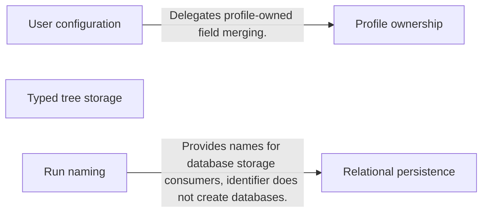
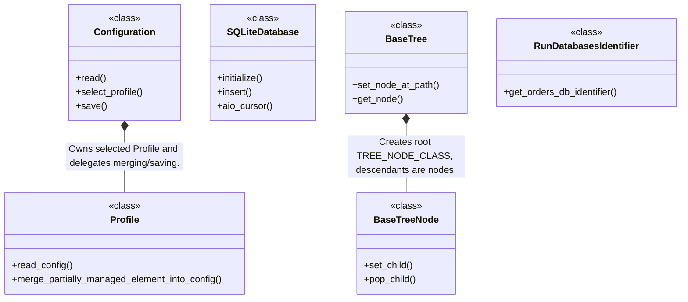
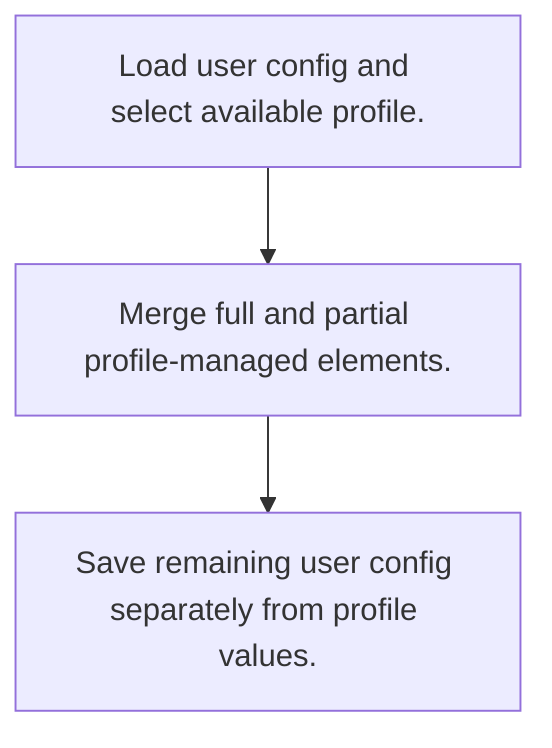
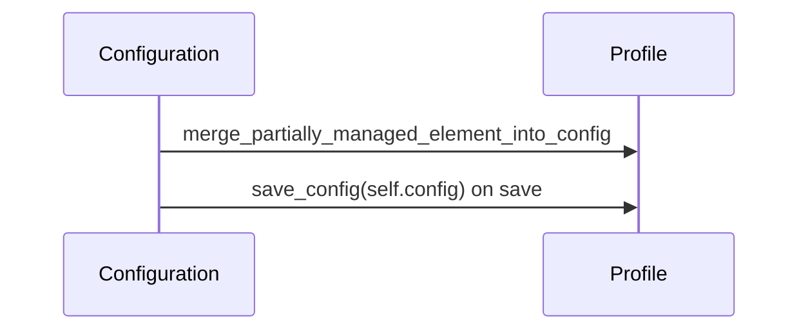

# OctoBot-Commons: workflow, design and architecture

Updated: **2026-10-13**
Reviewed Git hash: `c457d7838387127f54cbf9c98a36376c5a222b56`
Branch: `feature/ayu_develop`
Source diff SHA256: `e3b0c44298fc1c149afbf4c8996fb92427ae41e4649b934ca495991b7852b855`
Scope: **Shared configuration / persistence library** / Maintenance: **companion**
Languages: Python

[HTML edition](ayu-develop.html) / [Development](development.md) / [Historical validation](validation.md) / [Full system comparison](../../docs/index.html)

## Purpose and scope

Provide lower-layer profiles, configuration merging, tree structures and asynchronous database primitives for OctoBot packages.

## Features and support boundaries

Native = implemented here. Integration = supplied through a named host/API. Limited = material restriction. Not provided = evidenced scope exclusion. Unverified = support/absence not established. Not applicable = outside this artifact type.

| Capability | Status | Implementation and limits | Source |
|---|---|---|---|
| Backtesting | Not applicable | Lower-layer shared library; inspected modules provide storage/configuration/tree primitives and no execution host. | [Configuration.read](../src/octobot_commons/configuration/configuration.py) ([L66](https://github.com/alexcwyu/OctoBot-Commons/blob/c457d7838387127f54cbf9c98a36376c5a222b56/src/octobot_commons/configuration/configuration.py#L66)) / [SQLiteDatabase.initialize](../src/octobot_commons/databases/relational_databases/sqlite/sqlite_database.py) ([L60](https://github.com/alexcwyu/OctoBot-Commons/blob/c457d7838387127f54cbf9c98a36376c5a222b56/src/octobot_commons/databases/relational_databases/sqlite/sqlite_database.py#L60)) / [BaseTree.set_node_at_path](../src/octobot_commons/tree/base_tree.py) ([L85](https://github.com/alexcwyu/OctoBot-Commons/blob/c457d7838387127f54cbf9c98a36376c5a222b56/src/octobot_commons/tree/base_tree.py#L85)) |
| Live execution | Not applicable | Lower-layer shared library; inspected modules provide storage/configuration/tree primitives and no execution host. | [Configuration.read](../src/octobot_commons/configuration/configuration.py) ([L66](https://github.com/alexcwyu/OctoBot-Commons/blob/c457d7838387127f54cbf9c98a36376c5a222b56/src/octobot_commons/configuration/configuration.py#L66)) / [SQLiteDatabase.initialize](../src/octobot_commons/databases/relational_databases/sqlite/sqlite_database.py) ([L60](https://github.com/alexcwyu/OctoBot-Commons/blob/c457d7838387127f54cbf9c98a36376c5a222b56/src/octobot_commons/databases/relational_databases/sqlite/sqlite_database.py#L60)) / [BaseTree.set_node_at_path](../src/octobot_commons/tree/base_tree.py) ([L85](https://github.com/alexcwyu/OctoBot-Commons/blob/c457d7838387127f54cbf9c98a36376c5a222b56/src/octobot_commons/tree/base_tree.py#L85)) |
| Paper trading | Not applicable | Lower-layer shared library; inspected modules provide storage/configuration/tree primitives and no execution host. | [Configuration.read](../src/octobot_commons/configuration/configuration.py) ([L66](https://github.com/alexcwyu/OctoBot-Commons/blob/c457d7838387127f54cbf9c98a36376c5a222b56/src/octobot_commons/configuration/configuration.py#L66)) / [SQLiteDatabase.initialize](../src/octobot_commons/databases/relational_databases/sqlite/sqlite_database.py) ([L60](https://github.com/alexcwyu/OctoBot-Commons/blob/c457d7838387127f54cbf9c98a36376c5a222b56/src/octobot_commons/databases/relational_databases/sqlite/sqlite_database.py#L60)) / [BaseTree.set_node_at_path](../src/octobot_commons/tree/base_tree.py) ([L85](https://github.com/alexcwyu/OctoBot-Commons/blob/c457d7838387127f54cbf9c98a36376c5a222b56/src/octobot_commons/tree/base_tree.py#L85)) |
| Event driven | Unverified | Representative source review did not establish this capability; no claim of absence. | Not applicable to this repository scope. |
| Vectorized | Unverified | Representative source review did not establish this capability; no claim of absence. | Not applicable to this repository scope. |
| Order management | Not applicable | Lower-layer shared library; inspected modules provide storage/configuration/tree primitives and no execution host. | [Configuration.read](../src/octobot_commons/configuration/configuration.py) ([L66](https://github.com/alexcwyu/OctoBot-Commons/blob/c457d7838387127f54cbf9c98a36376c5a222b56/src/octobot_commons/configuration/configuration.py#L66)) / [SQLiteDatabase.initialize](../src/octobot_commons/databases/relational_databases/sqlite/sqlite_database.py) ([L60](https://github.com/alexcwyu/OctoBot-Commons/blob/c457d7838387127f54cbf9c98a36376c5a222b56/src/octobot_commons/databases/relational_databases/sqlite/sqlite_database.py#L60)) / [BaseTree.set_node_at_path](../src/octobot_commons/tree/base_tree.py) ([L85](https://github.com/alexcwyu/OctoBot-Commons/blob/c457d7838387127f54cbf9c98a36376c5a222b56/src/octobot_commons/tree/base_tree.py#L85)) |
| Order types | Not applicable | Lower-layer shared library; inspected modules provide storage/configuration/tree primitives and no execution host. | [Configuration.read](../src/octobot_commons/configuration/configuration.py) ([L66](https://github.com/alexcwyu/OctoBot-Commons/blob/c457d7838387127f54cbf9c98a36376c5a222b56/src/octobot_commons/configuration/configuration.py#L66)) / [SQLiteDatabase.initialize](../src/octobot_commons/databases/relational_databases/sqlite/sqlite_database.py) ([L60](https://github.com/alexcwyu/OctoBot-Commons/blob/c457d7838387127f54cbf9c98a36376c5a222b56/src/octobot_commons/databases/relational_databases/sqlite/sqlite_database.py#L60)) / [BaseTree.set_node_at_path](../src/octobot_commons/tree/base_tree.py) ([L85](https://github.com/alexcwyu/OctoBot-Commons/blob/c457d7838387127f54cbf9c98a36376c5a222b56/src/octobot_commons/tree/base_tree.py#L85)) |
| Multi venue | Unverified | Representative source review did not establish this capability; no claim of absence. | Not applicable to this repository scope. |
| Crypto | Unverified | Representative source review did not establish this capability; no claim of absence. | Not applicable to this repository scope. |
| Equities | Unverified | Representative source review did not establish this capability; no claim of absence. | Not applicable to this repository scope. |
| Futures | Unverified | Representative source review did not establish this capability; no claim of absence. | Not applicable to this repository scope. |
| Options | Unverified | Representative source review did not establish this capability; no claim of absence. | Not applicable to this repository scope. |
| Forex | Unverified | Representative source review did not establish this capability; no claim of absence. | Not applicable to this repository scope. |
| Strategy api | Not applicable | Lower-layer shared library; inspected modules provide storage/configuration/tree primitives and no execution host. | [Configuration.read](../src/octobot_commons/configuration/configuration.py) ([L66](https://github.com/alexcwyu/OctoBot-Commons/blob/c457d7838387127f54cbf9c98a36376c5a222b56/src/octobot_commons/configuration/configuration.py#L66)) / [SQLiteDatabase.initialize](../src/octobot_commons/databases/relational_databases/sqlite/sqlite_database.py) ([L60](https://github.com/alexcwyu/OctoBot-Commons/blob/c457d7838387127f54cbf9c98a36376c5a222b56/src/octobot_commons/databases/relational_databases/sqlite/sqlite_database.py#L60)) / [BaseTree.set_node_at_path](../src/octobot_commons/tree/base_tree.py) ([L85](https://github.com/alexcwyu/OctoBot-Commons/blob/c457d7838387127f54cbf9c98a36376c5a222b56/src/octobot_commons/tree/base_tree.py#L85)) |
| Optimization | Unverified | Representative source review did not establish this capability; no claim of absence. | Not applicable to this repository scope. |
| Machine learning | Unverified | Representative source review did not establish this capability; no claim of absence. | Not applicable to this repository scope. |
| Reinforcement learning | Unverified | Representative source review did not establish this capability; no claim of absence. | Not applicable to this repository scope. |
| Portfolio | Unverified | Representative source review did not establish this capability; no claim of absence. | Not applicable to this repository scope. |
| Risk management | Unverified | Representative source review did not establish this capability; no claim of absence. | Not applicable to this repository scope. |
| Performance analytics | Unverified | Representative source review did not establish this capability; no claim of absence. | Not applicable to this repository scope. |
| Historical data | Unverified | Representative source review did not establish this capability; no claim of absence. | Not applicable to this repository scope. |
| Streaming data | Unverified | Representative source review did not establish this capability; no claim of absence. | Not applicable to this repository scope. |
| Persistence | Native | Provides SQLite timestamped row storage and shared typed-tree/configuration primitives. | [SQLiteDatabase.initialize](../src/octobot_commons/databases/relational_databases/sqlite/sqlite_database.py) ([L60](https://github.com/alexcwyu/OctoBot-Commons/blob/c457d7838387127f54cbf9c98a36376c5a222b56/src/octobot_commons/databases/relational_databases/sqlite/sqlite_database.py#L60)) / [SQLiteDatabase.insert](../src/octobot_commons/databases/relational_databases/sqlite/sqlite_database.py) ([L89](https://github.com/alexcwyu/OctoBot-Commons/blob/c457d7838387127f54cbf9c98a36376c5a222b56/src/octobot_commons/databases/relational_databases/sqlite/sqlite_database.py#L89)) / [BaseTree.set_node_at_path](../src/octobot_commons/tree/base_tree.py) ([L85](https://github.com/alexcwyu/OctoBot-Commons/blob/c457d7838387127f54cbf9c98a36376c5a222b56/src/octobot_commons/tree/base_tree.py#L85)) |
| Data pipeline | Native | Provides SQLite timestamped row storage and shared typed-tree/configuration primitives. | [SQLiteDatabase.initialize](../src/octobot_commons/databases/relational_databases/sqlite/sqlite_database.py) ([L60](https://github.com/alexcwyu/OctoBot-Commons/blob/c457d7838387127f54cbf9c98a36376c5a222b56/src/octobot_commons/databases/relational_databases/sqlite/sqlite_database.py#L60)) / [SQLiteDatabase.insert](../src/octobot_commons/databases/relational_databases/sqlite/sqlite_database.py) ([L89](https://github.com/alexcwyu/OctoBot-Commons/blob/c457d7838387127f54cbf9c98a36376c5a222b56/src/octobot_commons/databases/relational_databases/sqlite/sqlite_database.py#L89)) / [BaseTree.set_node_at_path](../src/octobot_commons/tree/base_tree.py) ([L85](https://github.com/alexcwyu/OctoBot-Commons/blob/c457d7838387127f54cbf9c98a36376c5a222b56/src/octobot_commons/tree/base_tree.py#L85)) |
| Web ui | Unverified | Representative source review did not establish this capability; no claim of absence. | Not applicable to this repository scope. |
| Cli | Unverified | Representative source review did not establish this capability; no claim of absence. | Not applicable to this repository scope. |
| Monitoring | Unverified | Representative source review did not establish this capability; no claim of absence. | Not applicable to this repository scope. |
| Extension api | Native | Public configuration/profile/tree/database classes are reusable support APIs, not strategy runtime APIs. | [Configuration.read](../src/octobot_commons/configuration/configuration.py) ([L66](https://github.com/alexcwyu/OctoBot-Commons/blob/c457d7838387127f54cbf9c98a36376c5a222b56/src/octobot_commons/configuration/configuration.py#L66)) / [Profile.merge_partially_managed_element_into_config](../src/octobot_commons/profiles/profile.py) ([L280](https://github.com/alexcwyu/OctoBot-Commons/blob/c457d7838387127f54cbf9c98a36376c5a222b56/src/octobot_commons/profiles/profile.py#L280)) / [SQLiteDatabase.initialize](../src/octobot_commons/databases/relational_databases/sqlite/sqlite_database.py) ([L60](https://github.com/alexcwyu/OctoBot-Commons/blob/c457d7838387127f54cbf9c98a36376c5a222b56/src/octobot_commons/databases/relational_databases/sqlite/sqlite_database.py#L60)) |
| Native acceleration | Unverified | Representative source review did not establish this capability; no claim of absence. | Not applicable to this repository scope. |
| Distributed execution | Unverified | Representative source review did not establish this capability; no claim of absence. | Not applicable to this repository scope. |

## System components

| Component | Responsibility | Source |
|---|---|---|
| User configuration | Read/merge/save user and selected profile configuration. | [Configuration.read](../src/octobot_commons/configuration/configuration.py) ([L66](https://github.com/alexcwyu/OctoBot-Commons/blob/c457d7838387127f54cbf9c98a36376c5a222b56/src/octobot_commons/configuration/configuration.py#L66)) |
| Profile ownership | Merge and persist profile-owned values. | [Profile.merge_partially_managed_element_into_config](../src/octobot_commons/profiles/profile.py) ([L280](https://github.com/alexcwyu/OctoBot-Commons/blob/c457d7838387127f54cbf9c98a36376c5a222b56/src/octobot_commons/profiles/profile.py#L280)) |
| Relational persistence | Async timestamped SQLite operations and cursor ownership. | [SQLiteDatabase.initialize](../src/octobot_commons/databases/relational_databases/sqlite/sqlite_database.py) ([L60](https://github.com/alexcwyu/OctoBot-Commons/blob/c457d7838387127f54cbf9c98a36376c5a222b56/src/octobot_commons/databases/relational_databases/sqlite/sqlite_database.py#L60)) |
| Typed tree storage | Hierarchical nodes shared by evaluation/data consumers. | [BaseTree.set_node_at_path](../src/octobot_commons/tree/base_tree.py) ([L85](https://github.com/alexcwyu/OctoBot-Commons/blob/c457d7838387127f54cbf9c98a36376c5a222b56/src/octobot_commons/tree/base_tree.py#L85)) |
| Run naming | Identify per-run exchange-specific databases. | [RunDatabasesIdentifier.get_orders_db_identifier](../src/octobot_commons/databases/run_databases/run_databases_identifier.py) ([L89](https://github.com/alexcwyu/OctoBot-Commons/blob/c457d7838387127f54cbf9c98a36376c5a222b56/src/octobot_commons/databases/run_databases/run_databases_identifier.py#L89)) |

## Architecture and component boundaries

The component view summarizes inspected responsibility boundaries. Arrows identify the documented API/data dependencies; this is not a deployment-readiness claim.

- Delegates profile-owned field merging.: [Configuration._generate_config_from_user_config_and_profile](../src/octobot_commons/configuration/configuration.py) ([L118](https://github.com/alexcwyu/OctoBot-Commons/blob/c457d7838387127f54cbf9c98a36376c5a222b56/src/octobot_commons/configuration/configuration.py#L118))
- Provides names for database storage consumers; identifier does not create databases.: [RunDatabasesIdentifier.get_orders_db_identifier](../src/octobot_commons/databases/run_databases/run_databases_identifier.py) ([L89](https://github.com/alexcwyu/OctoBot-Commons/blob/c457d7838387127f54cbf9c98a36376c5a222b56/src/octobot_commons/databases/run_databases/run_databases_identifier.py#L89))

## Design decisions

| Decision | Rationale | Tradeoff | Evidence |
|---|---|---|---|
| Separate user-owned and profile-owned configuration. | Lets profiles override strategy settings while preserving global user preferences. | Correct output depends on each Profile managed-element contract. | [Configuration._generate_config_from_user_config_and_profile](../src/octobot_commons/configuration/configuration.py) ([L118](https://github.com/alexcwyu/OctoBot-Commons/blob/c457d7838387127f54cbf9c98a36376c5a222b56/src/octobot_commons/configuration/configuration.py#L118)) / [Configuration.save](../src/octobot_commons/configuration/configuration.py) ([L128](https://github.com/alexcwyu/OctoBot-Commons/blob/c457d7838387127f54cbf9c98a36376c5a222b56/src/octobot_commons/configuration/configuration.py#L128)) |

## Class and interface relationships

Each node is a reviewed source symbol. Function/module nodes are explicitly labeled; they do not imply Python classes. Only reviewed relationships are drawn.

- **Configuration** (class): [Configuration.read](../src/octobot_commons/configuration/configuration.py) ([L66](https://github.com/alexcwyu/OctoBot-Commons/blob/c457d7838387127f54cbf9c98a36376c5a222b56/src/octobot_commons/configuration/configuration.py#L66))
- **Profile** (class): [Profile.merge_partially_managed_element_into_config](../src/octobot_commons/profiles/profile.py) ([L280](https://github.com/alexcwyu/OctoBot-Commons/blob/c457d7838387127f54cbf9c98a36376c5a222b56/src/octobot_commons/profiles/profile.py#L280))
- **SQLiteDatabase** (class): [SQLiteDatabase.initialize](../src/octobot_commons/databases/relational_databases/sqlite/sqlite_database.py) ([L60](https://github.com/alexcwyu/OctoBot-Commons/blob/c457d7838387127f54cbf9c98a36376c5a222b56/src/octobot_commons/databases/relational_databases/sqlite/sqlite_database.py#L60))
- **BaseTree** (class): [BaseTree.set_node_at_path](../src/octobot_commons/tree/base_tree.py) ([L85](https://github.com/alexcwyu/OctoBot-Commons/blob/c457d7838387127f54cbf9c98a36376c5a222b56/src/octobot_commons/tree/base_tree.py#L85))
- **BaseTreeNode** (class): [BaseTreeNode](../src/octobot_commons/tree/base_tree.py) ([L18](https://github.com/alexcwyu/OctoBot-Commons/blob/c457d7838387127f54cbf9c98a36376c5a222b56/src/octobot_commons/tree/base_tree.py#L18))
- **RunDatabasesIdentifier** (class): [RunDatabasesIdentifier.get_orders_db_identifier](../src/octobot_commons/databases/run_databases/run_databases_identifier.py) ([L89](https://github.com/alexcwyu/OctoBot-Commons/blob/c457d7838387127f54cbf9c98a36376c5a222b56/src/octobot_commons/databases/run_databases/run_databases_identifier.py#L89))

## Workflow

### Read and persist a profile-aware configuration

1. Load user config and select available profile.. [Configuration.read](../src/octobot_commons/configuration/configuration.py) ([L66](https://github.com/alexcwyu/OctoBot-Commons/blob/c457d7838387127f54cbf9c98a36376c5a222b56/src/octobot_commons/configuration/configuration.py#L66))
2. Merge full and partial profile-managed elements.. [Configuration._generate_config_from_user_config_and_profile](../src/octobot_commons/configuration/configuration.py) ([L118](https://github.com/alexcwyu/OctoBot-Commons/blob/c457d7838387127f54cbf9c98a36376c5a222b56/src/octobot_commons/configuration/configuration.py#L118)) / [Profile.merge_partially_managed_element_into_config](../src/octobot_commons/profiles/profile.py) ([L280](https://github.com/alexcwyu/OctoBot-Commons/blob/c457d7838387127f54cbf9c98a36376c5a222b56/src/octobot_commons/profiles/profile.py#L280))
3. Save remaining user config separately from profile values.. [Configuration.save](../src/octobot_commons/configuration/configuration.py) ([L128](https://github.com/alexcwyu/OctoBot-Commons/blob/c457d7838387127f54cbf9c98a36376c5a222b56/src/octobot_commons/configuration/configuration.py#L128))

## Sequence

Configuration merge/save

- merge_partially_managed_element_into_config: [Configuration._generate_config_from_user_config_and_profile](../src/octobot_commons/configuration/configuration.py) ([L118](https://github.com/alexcwyu/OctoBot-Commons/blob/c457d7838387127f54cbf9c98a36376c5a222b56/src/octobot_commons/configuration/configuration.py#L118)) / [Profile.merge_partially_managed_element_into_config](../src/octobot_commons/profiles/profile.py) ([L280](https://github.com/alexcwyu/OctoBot-Commons/blob/c457d7838387127f54cbf9c98a36376c5a222b56/src/octobot_commons/profiles/profile.py#L280))
- save_config(self.config) on save: [Configuration.save](../src/octobot_commons/configuration/configuration.py) ([L128](https://github.com/alexcwyu/OctoBot-Commons/blob/c457d7838387127f54cbf9c98a36376c5a222b56/src/octobot_commons/configuration/configuration.py#L128))

## Strengths and limits

### Strengths

- Shared profile merging and typed node primitives support consistent host/package representations. [Configuration._generate_config_from_user_config_and_profile](../src/octobot_commons/configuration/configuration.py) ([L118](https://github.com/alexcwyu/OctoBot-Commons/blob/c457d7838387127f54cbf9c98a36376c5a222b56/src/octobot_commons/configuration/configuration.py#L118)) / [BaseTree.set_node_at_path](../src/octobot_commons/tree/base_tree.py) ([L85](https://github.com/alexcwyu/OctoBot-Commons/blob/c457d7838387127f54cbf9c98a36376c5a222b56/src/octobot_commons/tree/base_tree.py#L85))

### Limitations

- Trading/evaluator semantics belong to higher packages; this library cannot be compared as an independent trading engine. [Configuration.read](../src/octobot_commons/configuration/configuration.py) ([L66](https://github.com/alexcwyu/OctoBot-Commons/blob/c457d7838387127f54cbf9c98a36376c5a222b56/src/octobot_commons/configuration/configuration.py#L66)) / [SQLiteDatabase.initialize](../src/octobot_commons/databases/relational_databases/sqlite/sqlite_database.py) ([L60](https://github.com/alexcwyu/OctoBot-Commons/blob/c457d7838387127f54cbf9c98a36376c5a222b56/src/octobot_commons/databases/relational_databases/sqlite/sqlite_database.py#L60))

## Validation scope

The linked validation and command records preserve actual historical runs and user-authorized exclusions. This source/document review does not rerun application tests, establish live trading readiness or rank benchmark performance. Current data, credential and runtime prerequisites remain material.

[Repository validation](validation.md) / [Executed checks](maintenance/index.md)

## Source map

| Reviewed symbol/path | Inspected responsibility | Actual file SHA256 |
|---|---|---|
| [Configuration.read](../src/octobot_commons/configuration/configuration.py) ([L66](https://github.com/alexcwyu/OctoBot-Commons/blob/c457d7838387127f54cbf9c98a36376c5a222b56/src/octobot_commons/configuration/configuration.py#L66)) | Loads user config, copies it and loads/selects profiles if available. | `662e012475aaaf9ed5cc0d5959a8f9031a2a01b05437c7578c8a04b81517335d` |
| [Configuration._generate_config_from_user_config_and_profile](../src/octobot_commons/configuration/configuration.py) ([L118](https://github.com/alexcwyu/OctoBot-Commons/blob/c457d7838387127f54cbf9c98a36376c5a222b56/src/octobot_commons/configuration/configuration.py#L118)) | Overwrites fully profile-managed elements and merges partially managed elements via Profile. | `662e012475aaaf9ed5cc0d5959a8f9031a2a01b05437c7578c8a04b81517335d` |
| [Configuration.save](../src/octobot_commons/configuration/configuration.py) ([L128](https://github.com/alexcwyu/OctoBot-Commons/blob/c457d7838387127f54cbf9c98a36376c5a222b56/src/octobot_commons/configuration/configuration.py#L128)) | Writes non-profile user config and saves profile-managed config separately. | `662e012475aaaf9ed5cc0d5959a8f9031a2a01b05437c7578c8a04b81517335d` |
| [Profile.merge_partially_managed_element_into_config](../src/octobot_commons/profiles/profile.py) ([L280](https://github.com/alexcwyu/OctoBot-Commons/blob/c457d7838387127f54cbf9c98a36376c5a222b56/src/octobot_commons/profiles/profile.py#L280)) | Merges profile values/templates into global configuration for partially managed elements. | `4e1e28176eb0bbdbce3c50e47381be3de1d5ab8d4e7575a6caf70d997982c082` |
| [SQLiteDatabase.initialize](../src/octobot_commons/databases/relational_databases/sqlite/sqlite_database.py) ([L60](https://github.com/alexcwyu/OctoBot-Commons/blob/c457d7838387127f54cbf9c98a36376c5a222b56/src/octobot_commons/databases/relational_databases/sqlite/sqlite_database.py#L60)) | Opens asynchronous SQLite connection and cursor pool, initializes table list; maps DB errors. | `fbabd9bd13fd14874e23e61d8d92aab480b512ef30934fe7008bb92b75747e16` |
| [SQLiteDatabase.insert](../src/octobot_commons/databases/relational_databases/sqlite/sqlite_database.py) ([L89](https://github.com/alexcwyu/OctoBot-Commons/blob/c457d7838387127f54cbf9c98a36376c5a222b56/src/octobot_commons/databases/relational_databases/sqlite/sqlite_database.py#L89)) | Creates missing table and inserts timestamped row values. | `fbabd9bd13fd14874e23e61d8d92aab480b512ef30934fe7008bb92b75747e16` |
| [BaseTree.__init__](../src/octobot_commons/tree/base_tree.py) ([L67](https://github.com/alexcwyu/OctoBot-Commons/blob/c457d7838387127f54cbf9c98a36376c5a222b56/src/octobot_commons/tree/base_tree.py#L67)) | Instantiates BaseTreeNode root via TREE_NODE_CLASS. | `73547e57e947cb2ce0fc0f936fff474fd2a1edf44cbf31e127cb93e9cd057c73` |
| [BaseTree.set_node_at_path](../src/octobot_commons/tree/base_tree.py) ([L85](https://github.com/alexcwyu/OctoBot-Commons/blob/c457d7838387127f54cbf9c98a36376c5a222b56/src/octobot_commons/tree/base_tree.py#L85)) | Creates/traverses path and stores typed, timestamped node metadata. | `73547e57e947cb2ce0fc0f936fff474fd2a1edf44cbf31e127cb93e9cd057c73` |
| [BaseTreeNode](../src/octobot_commons/tree/base_tree.py) ([L18](https://github.com/alexcwyu/OctoBot-Commons/blob/c457d7838387127f54cbf9c98a36376c5a222b56/src/octobot_commons/tree/base_tree.py#L18)) | Stores node value/type/time/description/metadata and children. | `73547e57e947cb2ce0fc0f936fff474fd2a1edf44cbf31e127cb93e9cd057c73` |
| [RunDatabasesIdentifier.get_orders_db_identifier](../src/octobot_commons/databases/run_databases/run_databases_identifier.py) ([L89](https://github.com/alexcwyu/OctoBot-Commons/blob/c457d7838387127f54cbf9c98a36376c5a222b56/src/octobot_commons/databases/run_databases/run_databases_identifier.py#L89)) | Builds per-run/per-exchange order database identifiers. | `16badd4b763e76853d65d1cadba01cdbb54779fa752a8ff650a332bf00c27f92` |

## Documentation provenance

Review date: 2026-10-13. Full committed source HEAD: `c457d7838387127f54cbf9c98a36376c5a222b56`. Template version: 2. 5 source files were independently hashed for this guide.

[Evidence catalog](../../docs/systems-2026-10-13/catalog.json) / [Standard template](../../docs/guidelines/APP_TEMPLATE.md)

- Read-only source audit of inventory HEAD c457d7838387127f54cbf9c98a36376c5a222b56; no runtime execution, credential check or live-production assertion. Existing validation records remain separate historical evidence.
- Inspected implementation/configuration coverage: src/octobot_commons/configuration/configuration.py, src/octobot_commons/profiles/profile.py, src/octobot_commons/databases/relational_databases/sqlite/sqlite_database.py, src/octobot_commons/tree/base_tree.py, src/octobot_commons/databases/run_databases/run_databases_identifier.py
- Source symbols and call chains are representative coverage, not exhaustive connector, strategy or product certification. Integration statuses identify dependencies that supply the runtime behavior.
